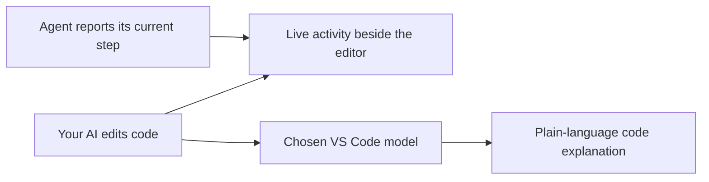

# AI Side Comments

[](https://github.com/Huankaii/ai-side-comments/actions/workflows/ci.yml)
[](LICENSE)
[](https://code.visualstudio.com/)

**Follow the work. Understand the code.**

A TypeScript extension that keeps live coding activity and plain-language explanations beside your code in VS Code. It helps you follow edits as they happen and understand what a function or changed excerpt actually does.

AI assistants can change several files before you have time to read the first one. AI Side Comments adds context where you are already working: a live activity panel, a short annotation at the changed line, and an expandable explanation.

**[Download the VSIX](https://github.com/Huankaii/ai-side-comments/releases/latest)** · **[Architecture](docs/architecture.md)** · **[Report a bug](https://github.com/Huankaii/ai-side-comments/issues)**



## Features

- Live edit activity in a panel beside the editor, with links back to the code.
- Streaming code explanations through a language model you choose in VS Code.
- Compact inline annotations and native, expandable gutter comments.
- A small JSON file bridge and extension API for agent-reported progress.
- Debounced requests, stale-response cancellation, bounded context, and no runtime npm dependencies.

This is an **initial preview** distributed through GitHub Releases. It is not published on the VS Code Marketplace. See [current limitations](#current-limitations) before integrating an agent.

## Try the progress demo

Clone and build this repository, start watching an empty test workspace in VS Code, and run:

```sh
node examples/agent-demo.cjs /path/to/test-workspace
```

The demo creates a small name-cleaning function, sends progress updates explaining it, and runs three assertions against the actual sample code. No model account is required for this demo; model-generated explanations are a separate feature. See the [demo walkthrough](docs/demo.md).

## Install and use

Requires **VS Code 1.95 or newer**.

1. Download `ai-side-comments-0.1.0.vsix` from [GitHub Releases](https://github.com/Huankaii/ai-side-comments/releases/latest). In VS Code, open Extensions, click the **…** menu, choose **Install from VSIX…**, and select the file.
2. Open your project folder and run **AI Side Comments: Start Watching** from the Command Palette (`Cmd+Shift+P` on Mac, `Ctrl+Shift+P` on Windows/Linux).
3. In the panel on the right, click **Enable** beside Code explanations. Select an available VS Code language model and grant its access request. A provider such as GitHub Copilot must expose a model through VS Code's Language Model API. Your provider's subscription and usage limits apply.
4. Ask your coding assistant to work. Edits appear immediately; after a short pause, explanations stream into the side panel. A short comment appears at the end of the changed line. Hover over it, or click its gutter comment, for the full explanation.

You can also select code, right-click, and choose **AI Side Comments: Explain Selected Code or File**. Without a selection, this explains a bounded excerpt around the cursor. Click a file update in the panel to jump to its code.

## What it shows

- **Observed edit**: actual document edits and file creation, changes, or deletion in the open workspace. It observes edits from humans and AI assistants alike; VS Code's generic edit events do not identify the author. Closed-file changes are shown at file level.
- **Agent progress**: explicit public progress updates from an integrated coding assistant, such as “Updating the login handler” or “Running the test suite.” The hook below supplies these updates.
- **Code explained**: a separate model explains what a code excerpt does: its purpose, key steps, inputs, outputs, and visible side effects. This describes the current code rather than producing a before-and-after diff review.

Private internal reasoning is not exposed. This extension does not read another extension's private chat or automatically capture all of its existing progress messages. Real planning and testing steps require the integration hook; without it, edit activity and code explanations still work.

## Connect your coding assistant

### File bridge (CLI agents and tools)

While watching, the extension reads `.ai-side-comments/progress.json` at the root of each workspace folder. Publish a new object with a **unique `id` for every update**:

```json
{
  "id": "login-task-002",
  "phase": "editing",
  "message": "Adding input validation before saving the user.",
  "file": "src/users.ts",
  "line": 24
}
```

Phases: `planning`, `editing`, `testing`, `done`, `error`. `file` and its one-based `line` are optional. The file path is relative to that workspace folder. Update the file atomically to prevent partial JSON reads; existing progress at the start of a watching session is not replayed. This is a latest-update bridge, not an event queue: updates overwritten within about 150 ms may be coalesced. Wait at least 250 ms between updates when each needs to be displayed.

After cloning this repository and running `npm ci --ignore-scripts` and `npm run compile`, the included zero-dependency helper handles atomic writes:

```sh
node /path/to/ai-side-comments/scripts/report-progress.cjs \
  --root /path/to/your/project \
  --phase editing \
  --message "Adding input validation before saving the user." \
  --file src/users.ts --line 24
```

Tell your assistant:

> Send short public progress updates to `.ai-side-comments/progress.json` as you work. Use unique ids and the documented phase/message/file/line fields. Explain your current action and useful results. Report actual test outcomes only after running the tests. Do not include private reasoning. Use atomic writes and allow at least 250 ms between updates.

The extension does not modify your repository to install this hook. Add `.ai-side-comments/` to your project's `.gitignore` if you use it.

### VS Code extension API

An agent extension can publish the same object via the exported API or a command. Watching must already be active:

```js
await vscode.commands.executeCommand('aiSideComments.reportProgress', {
  id: 'task-003', phase: 'testing', message: 'Running the authentication tests.'
});
```

```js
const extension = vscode.extensions.getExtension('local-tools.ai-side-comments');
const api = await extension?.activate();
api?.reportProgress({ id: 'task-004', phase: 'done', message: 'Authentication tests passed.' });
```

The exported API returns `true` when an update is displayed, and `false` when paused or deduplicated. Invalid payloads throw. Command/API paths refer to the first workspace folder; the file bridge supports each root independently. These steps are agent-reported, not independently verified by this extension.

## Controls and settings

Use the panel, Command Palette, or the **AI Comments** status bar button.

| Control | Effect |
| --- | --- |
| Start / Pause Watching | Start observing edits, or stop pending automatic work. |
| Enable / Disable Automatic Code Explanations | Choose a model and enable background explanations for this session, or stop automatic requests. |
| Explain Selected Code or File | Explain the selection or an excerpt around the cursor. Works while watching is paused. |
| Clear Comments and Activity | Remove comments and activity and cancel pending explanations. Watching remains as configured. |

| Setting | Default |
| --- | --- |
| `aiSideComments.showInline` | `true` |
| `aiSideComments.showGutterComments` | `true` |
| `aiSideComments.explanationDelayMs` | `2500` |
| `aiSideComments.maxFileBytes` | `200000` |
| `aiSideComments.excludedPaths` | Dependencies, build output, coverage, common lockfiles |

Additional exclusions support `*`, `**`, and `?` patterns. Common credential filenames such as `.env`, `.env.local`, `.npmrc`, `.key`, and `.pem`, Git metadata, bridge files, and common binary formats are always skipped. This is a filename filter, not a secret scanner; a code excerpt can still contain inline credentials.

## Data and behavior

The extension makes no model requests until you explicitly choose a model and use an explanation command. Enabling automatic explanations sends bounded excerpts of eligible changed files (up to 12,000 characters per request) to your chosen model while watching. It may also explain an excerpt of the current file when enabled during watching. No whole-repository upload, separate API key, telemetry, or extension-managed server is used.

Activity stays in memory: at most 120 updates and 80 file annotations. Reloading the window clears it and requires starting watching and enabling automatic explanations again. Streams are bounded and timed out; changed files invalidate their previous inline explanations. Watching is limited to trusted, local filesystem workspaces. A completed explanation is a model's reading of an excerpt and may miss context elsewhere in the project.

## Develop

```sh
npm ci --ignore-scripts
npm test
npm run test:host
npm run package
```

Open this folder in VS Code and press **F5** to launch an Extension Development Host. There are no runtime npm dependencies. Automated tests cover the progress protocol, exclusions, editor activity, streamed explanations, cancellation, provider errors, and trust checks using a VS Code API test double. A real-host smoke runner is included in `test/host.cjs`.

`npm run test:host` requires a local VS Code installation with `code` on your PATH. It opens an isolated development window with its own user-data and extension directories. It verifies activation, native comments, document edits, the filesystem bridge, pause, and clear without using your usual VS Code profile or making model requests.

GitHub Actions runs the automated tests on Node.js 22 and 24, then packages the extension and uploads a VSIX artifact. See [CONTRIBUTING.md](CONTRIBUTING.md) for the development workflow and [CHANGELOG.md](CHANGELOG.md) for releases.

## Current limitations

- Generic VS Code edit events do not identify AI authorship; observed activity includes human edits.
- Agent-reported planning and testing progress requires the integration hook. Private internal reasoning is unavailable.
- Explanations require a model provider exposing the VS Code Language Model API; provider access, consent, and usage limits apply.
- Explanations describe a bounded excerpt, rather than reviewing a full repository or comparing a complete before-and-after diff.
- Credential exclusions are filename filters, not a secret scanner.
- Automatic explanations and activity history are session-only. Remote and virtual workspaces are not supported in this preview.

## Validation

The initial version has **25 passing automated tests**. A native smoke test passed on VS Code **1.141.1** on macOS, including the real filesystem progress bridge. Model streaming and failure paths are tested with a deterministic API test double; provider-specific authentication and billing behavior need validation with your own provider.

The project was developed with AI assistance. Contributions and reproducible bug reports are welcome.

API references: [VS Code Language Model API](https://code.visualstudio.com/api/extension-guides/ai/language-model), [Webview API](https://code.visualstudio.com/api/extension-guides/webview), and [Commenting sample](https://github.com/microsoft/vscode-extension-samples/tree/main/comment-sample).
