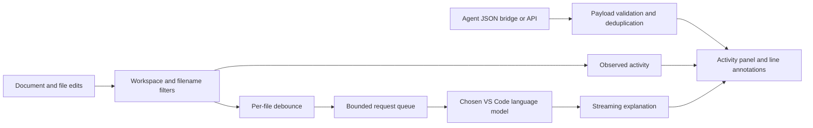

# Architecture and design decisions

AI Side Comments is a local VS Code extension written in TypeScript. It has no runtime npm dependencies and uses public editor APIs for document events, filesystem watchers, comments, decorations, webviews, and language models.

## Event flow

## Components

| Component | Responsibility |
| --- | --- |
| `src/extension.ts` | VS Code lifecycle, commands, watchers, scheduling, model requests, annotations, and panel state. |
| `src/core.ts` | Progress validation, exclusions, edit summaries, bounded inline text, and explanation prompts. |
| `src/panel.ts`, `media/` | A theme-aware webview; user-supplied and model text are inserted with `textContent`. |
| `scripts/report-progress.cjs` | Publish a validated progress object through an atomic file replacement. |
| `test/*.test.cjs` | Protocol and service behavior tests using a VS Code API test double. |
| `test/host.cjs` | Native integration checks against a real VS Code extension host. |

## Why separate observed edits from agent progress?

The editor's generic document-change events do not provide a reliable human-versus-AI author field. Calling every edit an AI action would misrepresent the evidence. Observed activity records that code changed; the progress bridge lets an agent explicitly state its current action or outcome. Reported test results are displayed as agent statements, not independently verified assertions.

## Why debounce and cancel?

A single coding task can generate many small edits. The default 2.5-second per-file debounce waits for edits to settle before requesting an explanation. Automatic work uses a serial queue with at most eight ready jobs and eight debounce timers. The newest queued job for a file supersedes its earlier queued job.

Each job carries a session epoch and, for document changes, a document version. The extension cancels an in-flight response when that file changes; it also checks the captured document version before attaching a completed explanation. Pause and clear invalidate the session epoch. These checks prevent an explanation generated for old code from becoming the current inline comment.

## Request and history bounds

- Code excerpts contain at most 12,000 characters, and are reduced further when token counting shows that the model's input budget would be exceeded.
- Files exceeding the configurable size limit are skipped.
- Explanations have a 45-second cancellation timeout and a 6,000-character response cap.
- In-memory activity is limited to 120 entries, annotations to 80 files, and deduplication to 500 update identifiers.
- Provider errors stop automatic retries until the user enables explanations again.

These bounds limit work and memory; they are design constraints rather than measured latency or cost guarantees. A provider must honor cancellation for a request to stop promptly.

## Model access and data handling

Choosing a model and enabling explanations are explicit user actions. A short initial request triggers the provider's consent flow. Background requests also check the extension's model-access state. The extension sends code excerpts through VS Code's Language Model API rather than managing API keys or a custom backend.

Workspace trust and filename exclusions gate both manual and automatic explanations. Exclusions cover common credentials and binary files, but cannot detect arbitrary inline secrets. A content security policy and text-only rendering reduce the risk of active content in progress messages and model output. Comments use untrusted Markdown with source text appended literally.

## Bridge tradeoff

The JSON file bridge is intentionally small enough for a CLI agent to use without a server. Unique IDs make duplicate filesystem events harmless. It holds only the latest update: rapid overwrites can coalesce, so it is unsuitable for a lossless event log. Multiple workspace roots are supported through one bridge file per root; the command/API integration resolves relative files against the first root.

## Validation and next steps

The initial release includes 25 automated tests and a native smoke test. The test double exercises model streams, stale responses, revoked permissions, provider errors, and size limits. The native runner checks actual activation, side-panel creation, comment creation, editor edits, filesystem progress, pause, and clear.

Useful follow-up work includes validating several live model providers, testing on Windows and Linux desktop hosts, and adding an optional durable progress queue. The current preview does not claim production adoption, performance gains, or comprehensive provider compatibility.
